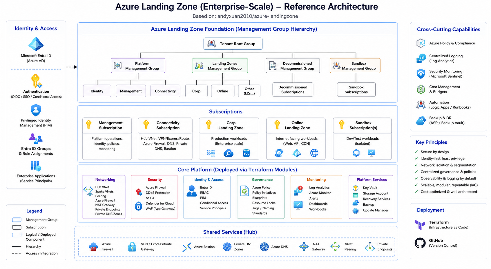

# Azure Landing Zone

Terraform landing zone repository for provisioning a shared Azure foundation and a small set of opinionated platform workloads.

This repo is a consumer of the shared Terraform modules pinned to an immutable commit in the upstream template repository. Its primary job is to compose those modules into a working landing zone, validate the root deployment path, and document the operating patterns used by this stack.

## What This Repo Does

- Provisions a shared root landing zone composition from `main.tf` and `variables.tf`, with environment-specific backend and variable files stored under `environments/<env>/`
- Consumes shared Terraform modules from the pinned upstream GitHub template repo
- Manages the current platform baseline for governance, networking, storage, Key Vault, App Service, Automation/ARI, and Linux runner resources
- Publishes validated snapshots to downstream repos through CI
- Acts as the main documentation entry point for this landing zone implementation

## Current Provisioned Scope

The current checked-in root configuration is wired to provision:

- Management groups and subscription bootstrap
- Shared resource group, Log Analytics workspace, storage account, and Key Vault
- Hub/spoke virtual networks, subnet layout, NSG associations, VNet peering, and private DNS
- App Service Plans, App Services, and optional Entra app registrations for enabled apps
- One optional Dev-only Free Static Web App for demo hosting
- Automation Account, Azure Resource Inventory runtime/runbook/schedule wiring, and supporting storage containers
- Linux runner/jumpbox resources and App Service deployment RBAC

For the detailed inventory, see [current-landingzone-resources.md](docs/80-reference/current-landingzone-resources.md) and [root-level-modules-guide.md](docs/20-repository/root-level-modules-guide.md).

### Dev Static Web App Demo

The Dev environment enables one Static Web App through `features.enable_static_web_apps`:

- `demo-platform-cc-dev`

The instance uses the upstream `staticwebapp` module with `sku_tier = "Free"` and `sku_size = "Free"`. The module does not create an App Service Plan. Sandbox and production keep this feature disabled by default because their `static_web_apps` maps are empty.

The Dev resource group remains in Canada Central, while the Static Web Apps use `eastus2` because `Microsoft.Web/staticSites` is not available in Canada Central for this subscription.

The current demo content is stored under [`static-web-apps`](static-web-apps). The Static Web App workflow deploys the `north-peak-cloud` site from `main`.

For content deployment methods, CI/CD examples, deployment-token handling, and verification steps, see [docs/30-deployment/static-web-app-deployment.md](docs/30-deployment/static-web-app-deployment.md).

## Enterprise AI Chatbot Architecture

This repository also contains the workload architecture for an enterprise document-grounded Retrieval-Augmented Generation (RAG) chatbot on Azure. The chatbot lets users ask questions through a browser UI, retrieves enterprise-controlled evidence from Azure AI Search, uses Azure OpenAI to generate grounded answers, validates citations, and returns answers with source previews.

The runtime is intentionally constrained: it does not perform public internet search. It answers only from content that has already been ingested, chunked, embedded, and indexed into Azure AI Search.



### Architecture Scope

The chatbot workload provisions app-specific resources and reuses shared services from the landing-zone platform.

Provisioned by the workload:

- Linux App Service Plan and Linux Python App Service for the browser UI and `/chat` API
- Microsoft Entra app registration for App Service authentication
- RAG storage container for ingested source documents
- Optional Azure AI Search query key
- Optional Azure OpenAI chat and embedding deployments

Reused from the landing zone:

- Shared resource group
- Storage account
- Key Vault
- Log Analytics workspace
- Azure OpenAI account
- Azure AI Service account
- Azure AI Search service

### Runtime Flow

1. The browser sends a user question, optional chat history, user groups, and metadata filters to `/chat`.
2. Microsoft Entra ID establishes identity context when App Service authentication is enabled.
3. The app rewrites follow-up questions and can expand them into multiple retrieval queries.
4. Azure OpenAI generates embeddings for retrieval queries.
5. Azure AI Search runs hybrid keyword and vector retrieval with metadata and access filters.
6. The app deduplicates candidates and can rerank them with Azure OpenAI.
7. Azure OpenAI generates a grounded answer from retrieved evidence.
8. The app validates citations before returning the answer, citations, source previews, and metadata.

### Security And Reliability Notes

- The browser is not an authorization boundary; retrieval authorization must be enforced in the backend.
- Search results must be filtered to authorized access groups before answer generation.
- Retrieved content is treated as untrusted evidence, not instructions.
- Missing or invalid citations should result in a conservative refusal.
- Authentication, authorization, retrieval, and grounding failures should fail closed.

For the full architecture, ingestion design, Terraform inputs, CI/CD notes, production checklist, and recommendations, see [architecture.md](docs/10-architecture/architecture-overview.md).

## Repo Layout

- [`main.tf`](./main.tf): root landing zone composition
- [`variables.tf`](./variables.tf): root inputs and validation
- [`environments/dev/terraform.tfvars`](./environments/dev/terraform.tfvars): current dev environment values and enabled features
- [`environments/dev/backend.hcl`](./environments/dev/backend.hcl): dev Azure remote-state backend configuration
- [`environments/sandbox/terraform.tfvars`](./environments/sandbox/terraform.tfvars): current sandbox environment values and enabled features
- [`environments/sandbox/backend.hcl`](./environments/sandbox/backend.hcl): sandbox Azure remote-state backend configuration
- [`outputs.tf`](./outputs.tf): root outputs
- [`docs/`](./docs/README.md): documentation map of content for this repo
- [`runbooks/`](./runbooks): Automation runbook templates used by the root deployment
- [`scripts/`](./scripts): bootstrap and helper scripts used by the landing zone
- [`.github/workflows/terraform.yml`](./.github/workflows/terraform.yml): GitHub Actions validation and publishing workflow
- [`azure-pipelines.yml`](./azure-pipelines.yml): Azure DevOps pipeline definition

The Static Web App demo is configured through the `static_web_apps` input in the Dev variable file. The root output `features.enable_static_web_apps` reports the provisioned names, hostnames, and SKU values without exposing deployment API keys.

## How To Work In This Repo

### 1. Update root inputs

Most day-to-day changes happen in:

- [`environments/dev/terraform.tfvars`](./environments/dev/terraform.tfvars)
- [`variables.tf`](./variables.tf)
- [`main.tf`](./main.tf)

Use outputs from one module wiring block to feed the next whenever possible instead of hard-coding Azure resource IDs into `terraform.tfvars`.

### 2. Tagging and naming inputs

`rg_tags` is the primary shared tag map used by the root composition. The root local `rg_tags` overrides the `Environment` tag from `var.environment` so short environment codes such as `sbx`, `dev`, and `prod` resolve to the expected business tag values.

The Azure tag key is `Workload`, and its value is added from `var.workload`. Keep `workload` between 4 and 8 characters; it is also used in generated resource names.

`common_tags` remains available as a legacy/special-case input, but root modules should use the effective `local.rg_tags` tag set unless there is a specific reason not to.

See [tagging-contract.md](docs/60-security-governance/tagging-contract.md) for the standardized root-owned tagging model used by this landing zone and the template modules.

### 3. Validate locally

Common local checks:

```powershell
# Select the Azure CLI account for this environment first, then export its IDs for the backend.
$Env:ARM_SUBSCRIPTION_ID = (az account show --query id -o tsv)
$Env:ARM_TENANT_ID       = (az account show --query tenantId -o tsv)

terraform fmt -recursive
terraform init -reconfigure -backend-config="environments/dev/backend.hcl" -lockfile=readonly
terraform validate
terraform plan -var-file="environments/dev/terraform.tfvars"
```

The `backend.hcl` files contain only state storage location and key. Terraform's AzureRM backend reads `ARM_SUBSCRIPTION_ID` and `ARM_TENANT_ID` from the process environment; GitHub Actions supplies them from the selected GitHub Environment, and Azure DevOps gets them from its Azure service connection.

If you are changing a shared module in the upstream template repo instead of this landing zone composition, do the module-level validation in that module repo as well.

### 4. Let CI validate the root composition

This repo's GitHub Actions workflow validates the landing zone root composition rather than running the full upstream module matrix. The module harness responsibility lives in the template repo; this repo focuses on whether this composed landing zone still plans successfully.

## Deployment And Operations

- Pipeline analysis and CI/CD behavior: [pipelines-guide.md](docs/40-pipelines/pipelines-guide.md)
- App Service deployment patterns: [app-service-deployment-methods.md](docs/30-deployment/app-service-deployment-methods.md) and [deployment-methods.md](docs/30-deployment/deployment-methods.md)
- App Service authentication modes and health-check access: [app-service-authentication.md](docs/30-deployment/app-service-authentication.md)
- Automation ARI design and runtime behavior: [automation-ari.md](docs/50-operations/automation-ari.md)
- Private endpoint and DNS lookup pattern guidance: [private-endpoint-private-dns.md](docs/10-architecture/private-endpoint-private-dns.md)
- Shared runner hygiene guidance: [shared-runner-hygiene.md](docs/40-pipelines/shared-runner-hygiene.md)

### FortiGate Marketplace Terms

Before the FortiGate VM can be deployed, an authorized subscription
administrator must review and accept the Fortinet Marketplace legal terms once
for the target subscription:

```powershell
az vm image terms accept `
  --subscription "YOUR-SUBSCRIPTION-ID" `
  --publisher "fortinet" `
  --offer "fortinet_fortigate-vm_v5" `
  --plan "fortinet_fg-vm"
```

Verify that the terms are accepted:

```powershell
az vm image terms show `
  --subscription "YOUR-SUBSCRIPTION-ID" `
  --publisher "fortinet" `
  --offer "fortinet_fortigate-vm_v5" `
  --plan "fortinet_fg-vm" `
  --query accepted
```

The verification command must return `true` before running the FortiGate
Terraform apply. Acceptance is a legal and subscription-level action and
requires the appropriate Azure Marketplace ordering permissions.

### FortiGate Network Topology

`features.enable_fortigate` is the single overall switch for the FortiGate
deployment. When it is `false`, the FortiGate VM, NICs, NSG, and FortiGate
subnets are not created.

When FortiGate is enabled, the module always creates its external and internal
subnets. `fortigate_create_dedicated_vnet` selects where those subnets live:

| Setting | Result |
| --- | --- |
| `fortigate_create_dedicated_vnet = false` | Create the FortiGate subnets in the shared landing-zone hub VNet. |
| `fortigate_create_dedicated_vnet = true` | Create a dedicated FortiGate VNet, then create the FortiGate subnets inside it. |

Shared hub mode uses `fortigate_external_subnet_prefixes` and
`fortigate_internal_subnet_prefixes`. Dedicated mode uses
`fortigate_virtual_network_address_space`,
`fortigate_dedicated_external_subnet_prefixes`, and
`fortigate_dedicated_internal_subnet_prefixes`.

Shared hub example:

```hcl
features = {
  enable_fortigate = true
}

fortigate_create_dedicated_vnet = false
```

Dedicated VNet example:

```hcl
features = {
  enable_fortigate = true
}

fortigate_create_dedicated_vnet              = true
fortigate_virtual_network_name               = "vnet-fortigate-platform-dev"
fortigate_virtual_network_address_space      = ["10.168.32.0/22"]
fortigate_dedicated_external_subnet_prefixes = ["10.168.32.0/24"]
fortigate_dedicated_internal_subnet_prefixes = ["10.168.33.0/24"]
```

Dedicated VNet creation does not add hub peering or route tables. Add approved
peering and routing separately before directing workload traffic through the
appliance.

## Docs At A Glance

- [README.md](./docs/README.md): map of content for the full `docs/` folder and the best place to navigate deeper.
- [current-landingzone-resources.md](docs/80-reference/current-landingzone-resources.md): fastest inventory of what this repo actually provisions today.
- [root-level-modules-guide.md](docs/20-repository/root-level-modules-guide.md): root Terraform wiring order, dependency flow, and which module patterns are active versus template-only.
- [pipelines-guide.md](docs/40-pipelines/pipelines-guide.md): side-by-side explanation of GitHub Actions versus Azure DevOps, including validation, artifact publishing, and apply behavior.
- [module-usage-and-dependencies.md](docs/20-repository/module-usage-and-dependencies.md): module-by-module dependency map and guidance for composing shared modules correctly.
- [modules-index.md](docs/20-repository/modules-index.md): index of module documentation and validation artifacts from the broader module ecosystem.
- [repository-modules-guide.md](docs/20-repository/repository-modules-guide.md): repository standards for validating, documenting, and contributing shared modules.
- [validation-summary.md](docs/70-validation/validation-summary.md): snapshot of module hardening and validation status captured during earlier repo work.
- [app-service-deployment-methods.md](docs/30-deployment/app-service-deployment-methods.md): the three App Service deployment patterns modeled in this landing zone and when to use each.
- [deployment-methods.md](docs/30-deployment/deployment-methods.md): broader deployment-method comparison across App Service delivery approaches.
- [app-service-plan-function-app-notes.md](docs/30-deployment/app-service-plan-function-app-notes.md): key plan and OS-matching constraints for Function Apps that share an App Service Plan.
- [automation-ari.md](docs/50-operations/automation-ari.md): how the Automation Account and Azure Resource Inventory workload are wired in this landing zone.
- [private-endpoint-private-dns.md](docs/10-architecture/private-endpoint-private-dns.md): reference implementation for private endpoint subnet and private DNS lookup patterns across modules.
- [shared-runner-hygiene.md](docs/40-pipelines/shared-runner-hygiene.md): reusable hygiene baseline for shared self-hosted runners.
- [git-extraheader-runner-issue.md](docs/40-pipelines/git-extraheader-runner-issue.md): troubleshooting note for Azure DevOps runner failures caused by lingering Git `extraheader` configuration.
- [aks-authentication-kubelogin.md](docs/30-deployment/aks-authentication-kubelogin.md): AKS access notes for `kubelogin`, `az aks get-credentials`, and the RBAC required for cluster access.

## Documentation Map

Start with the docs MOC:

- [README.md](./docs/README.md)

Recommended reading order for most contributors:

1. [current-landingzone-resources.md](docs/80-reference/current-landingzone-resources.md)
2. [root-level-modules-guide.md](docs/20-repository/root-level-modules-guide.md)
3. [pipelines-guide.md](docs/40-pipelines/pipelines-guide.md)
4. [module-usage-and-dependencies.md](docs/20-repository/module-usage-and-dependencies.md)
5. [repository-modules-guide.md](docs/20-repository/repository-modules-guide.md)
6. The topic-specific guides that match the area you are changing

## Related Notes

- This repo no longer needs to validate every upstream module harness in CI, because that belongs in the shared template/module repo.
- Some documents under `docs/` still describe the broader template ecosystem, not just the currently enabled landing zone subset. Use the root-level guide to distinguish what is active here today.
# Tagging

Reusable modules follow the tagging contract in [tagging-contract.md](docs/60-security-governance/tagging-contract.md). Root compositions own enterprise tag normalization and pass plan-known inherited tags through `inherited_resource_group_tags`; modules merge those tags with resource-specific `tags` without remapping `Environment` or `Workload`.

## Repository maintenance and security

Use Terraform 1.15.8 for the tested configuration (`>= 1.9, < 2.0` is supported by the root constraints). Shared modules are pinned to an immutable upstream revision and `.terraform.lock.hcl` is committed. Run `./test.ps1 -InitializeTerraform` for local checks and `terraform-docs --config .terraform-docs.yml .` after changing Terraform interfaces.

Shared storage and Key Vault now enforce deny-by-default ACLs. Review the environment allowlists, fixed runner egress, and SSH administrator access before applying. See [repository security controls](docs/60-security-governance/repository-security.md), [code standards](docs/60-security-governance/code-standards.md), [validation evidence](docs/70-validation/validation-summary.md), and the [change log](CHANGELOG.md).
